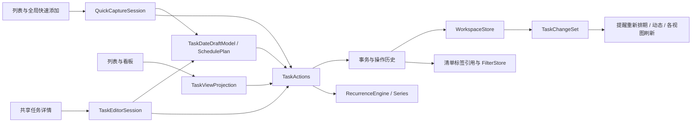

# 待办主链的滴答复刻方案

日期：2026-10-13。代码基线：`experiment/macos-native`，工作目录 `/Users/dongyangwei/Documents/学习/代办笔记/workfollow-macos-native`。滴答客户端基线：本机 8.0.80。

这份方案覆盖快速添加、共享详情、日期草稿、任务动作、列表与看板、重复任务和过滤器。目标是让同一条任务在这些入口里呈现相同状态、接受相同操作，并保留滴答已经确认的录入与重复语义。界面结构、功能语义和待补测的细节分别标注；像素参数由后续同窗口、同缩放截图测量，不在这里填猜测值。

## 1. 已有证据与复刻边界

| 标记 | 已确认内容 | 对设计的约束 |
| --- | --- | --- |
| RT-Q1：客户端实测 | 2026-10-13 周二，在滴答输入“下周一上午9点 REA日期比较”，预览为 19 日、下周一 09:00；只输入草稿，未创建任务。 | “下周”按自然周解析；本项目当前结果偏一周，先纠正。 |
| RT-Q2：客户端实测 | 滴答输入“明天9:00-10:00 REA时间段比较”，只把“明天9:00”识别为日期，后面的“10:00”保留普通文字，预览明天 09:00。本项目当前反而被第二个时刻覆盖为 10:00。 | 8.0.80 的复刻目标是保留第一个已识别的日期时刻；时间段由日期面板录入。自然语言时间段识别属于另行增强，不算现有滴答能力。该测试没有提交任务，创建后标题的确切处理仍需补测。 |
| OF-R1：官方文档，由主代理核对 | 重复支持到期日、完成日、自选日期三种类型，支持显示未来周期，以及修改单个周期。来源：[滴答重复任务说明](https://help.dida365.com/articles/6950660365923385344)。 | 新模型需要起算模式、虚拟未来周期和本次周期例外。 |
| REA-R1：本机模型元数据 | `TaskRecurringAdapter` 有 `recurrenceRuleStringAsRecurringObject`、`recurrenceFromAsRecurringObject`、`startDateAsRecurringObject`、`completionDateAsRecurringObject`、`excludedOccurrenceDatesAsRecurringObject` 等方法。证据文件：[REA 模型设计证据](/Users/dongyangwei/Documents/学习/代办笔记/workfollow-macos-native/docs/design/ticktick-replica-2026-10-14/rea-design-evidence.json)。 | 重复规则、起算来源、开始日、完成日、例外日期分开建模有一手结构依据；不能由方法名推断逾期完成后的跳期算法。 |
| REA-R2：本机界面资源 | `TTDatePickerCustomRepeatVC.nib` 包含 Every、Week、First、Sunday、First workday、Due Date、OK、Cancel；连接包含 `freqPopButtonClicked:`、`monthOrdinalPopButtonClicked:`、`onTheWeekdayPopButtonClicked:`、`workDayOrdinalPopButtonClicked:`、`repeatTypeClicked:`。证据文件：[REA 界面设计证据](/Users/dongyangwei/Documents/学习/代办笔记/workfollow-macos-native/docs/design/ticktick-replica-2026-10-14/rea-design-evidence.json)。 | 自定义重复应有频率、间隔、星期、每月序数/工作日序数、起算类型和明确的确认/取消。每一种组合的动态布局、确切文案还需运行补测。 |
| REA-R3：本机界面资源 | 有 `TTRepeatChangeAlertViewController.nib`；补充解码确认 `onlyThisButton`、`thisAndFutureButton`、`allNotCompletedButton` 三个出口。 | 可以确认三种范围选择控件存在；具体字段覆盖、已有例外和完成记录如何处理仍须补测。 |
| REA-T1：本机界面资源 | `TTTaskDetailTopView.nib` 有 Set Date 和若干按钮、文字对象。 | 详情顶部日期入口有结构依据；具体排列、悬停、图标与状态需对照运行截图。 |
| CODE：当前实现和独立复现 | 已有日期/时间段草稿、提醒、农历重复、艾宾浩斯、文件夹、分组、看板、关键词过滤器、共享正文编辑器及业务撤销。 | 保留这些已可用模块，集中修语义和入口差异。 |

REA 的资源连接和模型方法用于确定模块与字段，运行观察用于确定用户操作后的结果。当前没有逐项实测的菜单、候选和拖动行为，在下文保留“待补测”标记。

## 2. 模块边界



| 模块 | 负责 | 与当前代码的衔接 |
| --- | --- | --- |
| `QuickCaptureSession` | 原文、光标范围、识别项、已忽略项、人工属性覆盖、描述、候选状态、待提交任务。 | 从 `TaskListView` 与 `GlobalQuickAddPanelView` 收拢重复状态；继续使用 `QuickAddParser`、`QuickAddComposition` 和现有原生输入桥。 |
| `TaskEditorSession` | 固定 taskID、打开来源、标题/正文编辑身份、子任务导航、临时菜单与关闭返回行为。 | 保留 `TaskInspectorShell`、`DocumentEditorHandle`，让侧栏详情、日历弹层、四象限弹层使用同一个编辑器上下文。 |
| 日期草稿 | 日期、时刻、时间段、截止、提醒、重复的暂存与确认。 | 保留 `TaskDateDraftModel` 与 `SchedulePlan`，补字段变更范围和重复作用范围，避免另造日历专用编辑器。 |
| `TaskViewProjection` | 过滤、分组、排序、父子树、完成区、视图身份。 | 基于 `TaskListProjection`；把已排序结果一次提供给列表和看板。 |
| `TaskActions` | 一次用户动作产生的领域修改。 | 延续当前集中动作层；快速添加、拖动、日期确定、重复变更都交给它。 |
| 操作历史 | 一步操作对应一个撤销/重做条目，保存受影响实体的前后值和选择落点。 | 由当前 `WorkspaceStore` 撤销快照逐步扩展，不先替换存储实现。 |
| `RecurrenceEngine` 与 Series | 名义周期、实际排期、起算方式、完成/跳过、例外、未来投影。 | 保留现有农历、公历钳制和调休日历算法；增加周期身份与例外层。 |
| 稳定引用 | 清单、标签、分组、过滤器和视图偏好按身份关联；名字只用于显示。 | 先增加 ID 和兼容读取，再逐步替代当前名称字符串关联。 |

## 3. 快速添加：自然周、时刻与候选

### 3.1 解析规则

解析输出先分成日期片段、时刻片段、重复片段、标签、清单、优先级，再由组合器生成一份任务草稿。日期与时刻的有效来源要随草稿保存，不能在遍历候选时反复覆盖最终 `dueAt`。

- 本周起点使用产品设定的每周第一天；“本周一/下周一/下下周一”从该起点偏移。裸“周一”单独处理，是否指最近未来一天由客户端补测固定，不能与自然周共用当前 modulo 算法。
- 已确认的 8.0.80 行为：对“明天9:00-10:00”，采用第一个完整日期时刻，第二个时刻留在标题。列表与全局入口必须一致。
- “今天9点”但当前已过9点、没有日期的“9点”、本周已过的星期几，列为录入补测用例。先确认滴答预览，再定是否跨日；不把“自动明天”默认为滴答事实。
- 识别项删除后，原文仍然存在、该片段退出结构化识别；是否符合滴答的 chip 删除行为需补测。现有掩码重解析可复用。
- 人工打开日期面板后确认的值优先于解析结果；再改标题不悄悄覆盖人工日期、清单、标签或优先级。用户清除覆盖时才回到解析值。
- 中文“二十一点”等由完整中文数值转换处理，避免当前逐位累积成错误数字。支持词表先按滴答实测形成固定用例集。

### 3.2 输入和弹层契约

| 触发 | UI 状态 | 提交与副作用 | 撤销 |
| --- | --- | --- | --- |
| 输入日期、优先级、清单或标签 | 原文保持可编辑；已识别区段着色，属性摘要与草稿使用同一结果。 | 仅改草稿；不创建任务、不登记提醒。 | 原生文本撤销；草稿动作不进入任务业务历史。 |
| 光标处输入 `#` 或 `@` | 候选服务于光标附近的标记区段，继续输入仍留在输入框；光标移回中间也能编辑同一标记。 | 从 field editor 回传真实 UTF-16 选区，按候选区段替换，而非固定替换行尾。 | 原生文本撤销回到选择候选之前。 |
| 候选展开时上下键、回车、Tab、Esc | 高亮和层级按实测键序；Esc 先关闭候选，保留输入。 | 选择候选只改原文和草稿；具体回车/Tab分工先补测滴答，再作为共享状态机的合同。 | 不产生业务历史。 |
| 在快速添加里打开日期/属性 | 进入共用草稿面板；关闭后恢复标题输入焦点和插入点。 | 面板确定只更新 `QuickCaptureSession`；任务尚未创建。 | 返回面板前草稿或用原生编辑撤销，最终仍未影响已有任务。 |
| 单条提交 | 新任务进入所属清单/日期/标签/分组；输入保持连续添加状态。 | 一个 `CreateTaskCommand` 写入标题、描述、排期、提醒、重复、引用，发布一次变化。 | 一步删除本次创建，并恢复可继续输入的草稿落点。 |
| 粘贴多行并提交 | 显示将创建的任务数量；每行独立显示/采用识别结果。 | 一次 `CreateTasksCommand`，所有行一个事务；人工公共属性按面板显示的范围应用。 | 一步撤销整批，而不是当前每条逐个撤销。 |

候选条数、宽度、出现位置、精确匹配后是否收起、粘贴多行的展示，均以补测截图与键盘回放结果为准。本项目当前候选最多六项且仅服务行尾是源码事实，不是滴答规格。

## 4. 详情与日期面板：同一编辑器、同一草稿

### 4.1 详情内容与层级

保留现有正文编辑器，把任务详情壳与打开来源拆开。信息区域维持顶部状态/日期/优先级、标题与正文、子任务、底部清单与操作；每个区域的具体位置、字重、留白和悬停出现内容由同尺寸滴答截图确定。当前源码中沿用 Flutter 的尺寸和注释不作为滴答像素基准。

建议 `TaskEditorSession` 固定 `taskID` 与 `presentationContext`。打开某条日历任务后，日期面板始终编辑该 taskID；切换另一条任务时，先完成现有编辑器的输入法与正文提交，再创建下一会话。保留已有 `selectionWillChange → prepareForDocumentChange()` 路径。

| 触发 | UI 状态 | 提交与副作用 | 撤销 |
| --- | --- | --- | --- |
| 列表、看板、日历或四象限点任务 | 用同一详情内容，按来源展示侧栏或浮层；关闭返回原视图和位置。 | 打开不写任务；选择只保存界面状态。 | 无业务撤销。 |
| 改标题或正文 | 继续当前文本会话；所有入口显示相同任务内容。 | 复用 `commitText/commitEditorReference`；文本编辑不逐字挤入业务撤销栈。 | 文本 first responder 处理标准撤销/重做。 |
| 点子任务 | 同一编辑器切换到子任务；保留父任务回退入口。 | 编辑子任务本身，不用另一套阉割版详情。 | 文本与业务分别按同一规则撤销。 |
| 点日期或时刻 | 打开共用 `TaskDateDraftModel`，标题仍指向当前任务。 | 打开及浏览只改日期草稿。 | Esc 按子页→属性页→主面板退回，未确定就不写任务；与滴答实际关闭提交策略补测对齐。 |
| 在日期/时间段页选择日期、时刻、提醒、重复 | 当前值、摘要、重复预览一致；“安排结束”与“截止日期”分开。 | 子面板确定回主草稿，主面板确定才形成一个 `SchedulePlan`。 | 主面板取消丢弃全部本次日期草稿。 |
| 确定安排日期 | 列表日期、日历任务块、四象限投影、提醒状态同时更新。 | 一个 `SetScheduleCommand`，包含日期、时刻、时间段、提醒和已编辑重复字段；发布一次变化。 | 一步恢复原排期及提醒，选中原任务。 |
| 清除安排或清除截止 | 菜单/按钮清楚表达清除哪个字段；UI立即反映结果。 | 保持当前安排与截止分离的模型；最终清除是否连带移除重复、提醒，按滴答补测固定，不能照 Flutter 注释当目标。 | 一步恢复清除前的相关字段。 |
| 从日历拖动任务后打开详情 | 日期面板读取拖动后的真实安排；时长与时刻保持。 | 拖动和面板提交都走 `SchedulePlan`；日历不各自拆字段写入。 | 拖动是一步，后续日期确定是下一步。 |

当前 `TaskDateDraftModel` 已在确定时读最新任务，并能保留未编辑的重复规则。设计继续沿用这套能力，补 `changedFields` 或等价变更范围，使截止、提醒、重复和安排不会因宿主映射再次丢字段。

任务“开始番茄/正计时”从列表右键、看板右键、详情操作进入同一应用级接口，并采用相同关联任务、运行状态和窗口反馈。估算与专注统计区域由专注模块方案提供，详情壳只提供可插入位置。

## 5. 原子动作与撤销/重做

### 5.1 一次用户动作对应一个事务

直接复用集中式 `TaskActions`。为现有动作补统一结果：受影响 taskID、选择落点、变更前后值和操作名称。日期确定、移到清单并指定分组、整批创建、父任务完成并生成下一期、清单改名并更新引用，分别只产生一个历史条目。

历史条目同时保存 `before` 和 `after`；撤销把当前条目移到重做栈，重做应用保存的 after，不重新调用生成 UUID、当前时间或下一期日期的业务逻辑。这样重做重复任务不会生成另一套实例或改变关联。

现有 `undoTextRebases` 用于保证业务撤销不覆盖后来输入的正文。扩展重做时也保留这一边界，业务前后值只恢复自身字段，文本仍由编辑会话负责。

### 5.2 键盘与反馈

| 触发 | UI 状态 | 提交与副作用 | 撤销/重做 |
| --- | --- | --- | --- |
| 文本输入区按 `⌘Z / ⇧⌘Z` | 撤销或重做当前文本操作，选区跟随恢复。 | 走原生 first responder，不越过文本会话去改任务状态。 | 文本自己的历史。 |
| 非文本任务视图按 `⌘Z / ⇧⌘Z` | 菜单可用状态和“撤销××/重做××”更新；选择回到受影响任务。 | 走业务操作历史。 | 保存的 before/after；重做不重新计算。 |
| 完成或删除后的反馈条点撤销 | 恢复反馈条对应的当前操作；后续业务操作会更新反馈条。 | 反馈条持有 operationID，与菜单使用同一执行入口和同一历史条目。 | 采用当前历史顶端条目的整体撤销，不另建中间步骤的选择性回退机制。 |
| 撤销日期、分组、批量任务或重复完成 | 多个视图、计数、提醒一起恢复；当前列表能看到恢复的任务。 | 通过同一个 `TaskChangeSet` 重新排期、刷新投影并记录动作。 | 不直接手改 UI 数组。 |

视图排序/分组属于视图偏好，切换它们不挤入任务业务历史。文本编辑、任务动作与实际专注时长分别有明确边界；撤销一个任务动作不会回拨已发生的计时时间。滴答业务撤销是否支持哪些连续操作、反馈条时机与菜单文案，需补测后填写最终 UI 合同。

## 6. 列表与看板：共用排序分组，补全操作入口

### 6.1 共用投影

`TaskViewProjection` 输入 scope、过滤器、grouping、sortMode、descending、hidesCompleted，输出稳定 groupID、已排序根任务、父子树、计数与可接受的拖动意图。

先修两个已确认的问题：看板不调用排序，清单/标签视图选择日期分组仍平铺。自定义分组是任务归属，按日期/优先级是展示规则；内部增加明确的 section grouping 表达，不能存在分组后就无声忽略用户选择。界面如何切换自定义分组与智能分组，由滴答清单与看板补测定稿。

分组身份使用 sectionID、日期、priority、listID 或 tagID，不用显示标题做身份。若滴答实测证实多标签任务应出现在多个标签组，视图行身份使用 `(groupID, taskID)`；这可以保留重复展示，不会改变任务实体身份。

### 6.2 操作契约

| 触发 | UI 状态 | 提交与副作用 | 撤销 |
| --- | --- | --- | --- |
| 改排序/方向 | 列表和看板使用同一已排序任务序列。 | 只写该视图偏好；切回手动排序恢复原手动顺序。 | 任务业务历史不增加。 |
| 改分组 | 当前视图实际换分组；计数、空组呈现与滴答一致。 | 只改投影；不顺手修改任务归属。 | 同上。 |
| 点看板卡片空白处 | 打开共享详情，卡片保持选择反馈。 | 只选择任务。 | 无业务历史。 |
| 点看板任务勾选框 | 与列表同样的完成反馈与状态；点击不额外打开详情。 | 调用同一 `CompleteTaskCommand`。 | 普通任务恢复；重复任务同时移除下一期并恢复原周期。 |
| 看板卡片右键 | 使用列表同一动作定义、相同禁用状态和日期子面板。 | 优先级、清单、分组、日期、专注等统一路由。 | 每个完成动作一个业务条目。 |
| 在列内添加 | 新建条已带目标列对应属性；提交后新卡片出现在该列。 | `CreateTaskCommand` 带显式 group intent。 | 一步撤销新任务。 |
| 拖动自定义分组列 | 目标列显示明确落点，释放后卡片换列。 | 设置 sectionID；保留其余属性。 | 一步恢复原分组及顺序。 |
| 在优先级/清单/日期列之间拖动 | 按对应属性显示预览，释放后列表和详情同步更新。 | typed intent 分别映射 `SetPriority`、`MoveToList`、`MoveSchedule`；日期移动保留时刻和时长。是否开放这些拖动，以滴答实测确认后启用。 | 一步恢复原属性。 |
| 同列手动重排 | 显示插入落点；重排后的顺序在列表与看板一致。 | `ReorderTaskCommand` 改该列表/分组中的手动序。 | 一步恢复原顺序。 |

按创建时间等不能直接修改归属的展示分组，不采用“看起来能拖、放下无变化”的反馈。是否显示空优先级列、已完成列、子任务摘要、卡片标签文字以及列宽，均属于看板补测项目。

## 7. 重复模型：起算方式、多星期几、例外与稳定周期身份

### 7.1 建议数据形状

保留任务 UUID 作为已落地任务实例的身份，增加重复系列与周期引用。已有专注、提醒、笔记关联仍指向原 taskID；不会因为引入 series 而更换这些身份。

```swift
struct TaskSeries {
    let id: UUID
    var template: TaskSeriesTemplate
    var rule: RepeatPattern
    var base: RepeatBase
    var ending: RepeatEnding
    var timeZoneID: String
    var anchorDate: LocalDate
}

enum RepeatBase {
    case dueDate
    case completionDate
    case explicitDates([LocalDate])
}

struct RepeatPattern {
    var frequency: RepeatFrequency
    var interval: Int
    var weekdays: Set<Int>
    var monthDays: Set<Int>
    var monthlyOrdinal: MonthlyOrdinal?
    // 现有农历/调休日历规则继续归此模型。
}

struct OccurrenceKey {
    let seriesID: UUID
    let nominalDate: LocalDate
    let ordinal: Int
}

struct OccurrenceOverride {
    let occurrence: OccurrenceKey
    var actualSchedule: TaskSchedule?
    var outcome: OccurrenceOutcome
    var overrides: OccurrenceOverrideFields
}
```

`nominalDate` 是该周期原本的日期，`actualSchedule` 是本次改期后的安排。只改本次不能把全系列的下一次锚点也改掉。跳过、完成、本次改期落在同一个周期引用上；多个视图读取同一个例外。

`monthlyOrdinal` 对应 REA 已观察到的每月序数、星期和工作日序数入口。多星期几的具体控件还需补测；模型现在只有单个 weekday，需要先补表达能力。艾宾浩斯的进度另存，不继续借一般间隔字段同时承载已完成次数。

### 7.2 当前与未来周期

- 已落地的当前任务保留现有 taskID；完成后保留记录。下一期创建时继承清单、标签、分组及系列模板字段，直接修复现在丢 sectionID 的问题。
- 未来周期使用 `OccurrenceKey` 做稳定视图身份，按可见日期范围投影，不为日历每次刷新产生新实体。点未来周期编辑后才 materialize 成任务，并保存其周期引用。日历、待办统一使用 `TaskSeries / OccurrenceKey / OccurrenceOverride` 命名。
- 完成日起算依赖真实完成时间。未完成之前，后续准确日期尚未成立；滴答在此模式下如何展示未来周期要补测，不能把固定到期日预览当作完成日预览。
- 到期日起算的逾期任务完成后，是否连续保留历史未做周期、跳到未来日期或有相关选项，必须运行补测。引擎分开 `nominalNext` 和实际下一期策略，防止当前规则直接固定成滴答规格。
- 本次变更和整个重复规则的变更使用显式作用范围。补充 REA 解码已经确认 `onlyThisButton / thisAndFutureButton / allNotCompletedButton`，因此按三种范围组织草稿与动作；系列分段、字段覆盖及既有例外的处理仍需运行补测，补测后冻结具体文案和行为。

### 7.3 操作契约

| 触发 | UI 状态 | 提交与副作用 | 撤销 |
| --- | --- | --- | --- |
| 日期面板打开自定义重复 | 显示频率、间隔、起算方式，按选择显示星期/月份/序数/自选日期；下方结束条件与预览一致。 | 只改草稿；用同一引擎算预览。 | 取消回到进入前重复草稿。 |
| 确定到期日/完成日/自选日期规则 | 详情摘要显示真实起算方式；日历是否有未来周期跟随显示设置。 | 一个 `SetRecurrenceCommand` 保存系列、规则、结束条件及当前周期关系。 | 一步恢复旧系列规则与当前任务安排。 |
| 完成重复任务 | 本期完成，选中与新实例的跳转按滴答实测；下一期保留原分组。 | 单事务写本期 outcome、新实例、子任务和系列进度。 | 同一步恢复本期、移除生成实例及子任务，提醒重新排期。重做恢复同一实例身份。 |
| 跳过此周期 | 本期从未完成投影退出，下一期与完成语义保持一致。 | 写该周期例外；完成量不误增，次数消耗规则按滴答补测固定。 | 恢复原周期并撤回新实例/例外。 |
| 只改本次日期/属性 | 只该周期移动，其他周期保留名义规则。 | 保存 occurrence override；实际提醒读取改期后的 schedule。 | 清除本次变更，恢复名义安排。 |
| 改整个重复规则 | 作用范围选择与滴答弹层一致；已完成记录保留为历史。 | 统一更新系列与受影响当前/未来周期，发布一次变化。 | 恢复规则、周期引用和相关实例。 |
| 在多个视图点同一未来周期 | 日期与标题一致，选中的是同一周期。 | 如需落地，复用该 occurrence 已保存的 taskID。 | 撤销本次修改，不创建重复的未来任务。 |

## 8. 过滤器与清单标签：稳定引用和改名联动

当前清单、标签和过滤器按名称连接。`saveList/renameTag` 只更新任务，过滤器保留旧名称；正常改名后会突然没有结果。先补引用身份，再扩大过滤器表达力。

建议增加 `TaskListEntity(id, name, …)` 与 `TaskTagEntity(id, name, parentID?, …)`，任务和过滤器持有 ID。清单文件夹、sectionID 已有身份继续保留。视图偏好从 `list:名称/tag:名称` 迁到对应 ID，改名不再丢排序、分组和看板状态。

过滤器表达式用有类型的条件节点：清单/标签引用、优先级、日期条件、关键词，组合为 all/any/not。UI 的普通/高级模式、各条件的默认并且/或者关系、具体词法以滴答过滤器运行观察为准；不能把当前固定 AND 或建议表达式直接叫滴答完整语法。

| 触发 | UI 状态 | 提交与副作用 | 撤销 |
| --- | --- | --- | --- |
| 创建或编辑过滤器 | 选择条件即预览命中数量和结果；保存前保留原过滤器。 | 确定后一个过滤器编辑动作；任务不变。 | 一步恢复上次条件。 |
| 改清单或标签名 | 侧栏、任务属性、过滤器条件、视图标题同步显示新名字，结果保持。 | 只改实体名字；过渡期的旧名称引用与视图偏好一并更新。 | 一个操作恢复名字与过渡引用，不要求用户手工改每个过滤器。 |
| 拖动标签设置父子关系 | 树形侧栏显示归属；现有任务仍有原标签身份。 | 改 tag parentID；包含子标签的匹配方式按滴答补测确定。 | 一步恢复原父级与顺序。 |
| 从过滤器结果执行日期、完成、移动等任务动作 | 任务是否仍符合条件由统一评估器决定；退出结果时反馈清楚。 | 任务动作与其他视图同一路由；过滤器自身不被改写。 | 恢复任务后重新命中并定位。 |
| 在过滤器页创建任务 | 创建落点和默认属性明确，可预见提交后是否保留在结果中。 | 满足单值条件时能预填；复合条件的默认行为先实测滴答，避免自行猜成自动修改整套条件。 | 一步撤销任务创建。 |

标签颜色、子标签、清单归档等组织入口在此模块预留，但菜单位置、是否显示计数和空标签规则需补测，不与稳定引用改造捆绑成一次大 UI 重做。

## 9. 迁移兼容

迁移按 additive 字段和分阶段读取做，旧档案保持可打开。

1. 清单、标签：按现有准确名称建立一次 ID 映射。任务、过滤器和视图偏好一起迁移；保留旧 name 字段作为过渡读取与旧版导出需要的显示信息。新操作只以 ID 决定关系，改名不改变 ID。
2. 重复规则：缺 `base` 的旧规则按当前实现迁为到期日起算；单 `weekday` 迁为集合；`monthDay` 迁为单项；农历、结束日期、剩余次数照原语义读取。
3. 系列：对现有活动重复任务建立系列，保留该任务 UUID。不按标题、日期或相似内容拼接旧的已完成任务链；旧历史继续作为原任务记录显示。新产生的周期才拥有稳定 series/occurrence 引用。
4. 艾宾浩斯：将当前借 `interval` 保存的进度迁到独立进度字段，预览与完成读取同一进度。
5. 操作历史：延续当前仅在运行会话保存历史的做法，增加 redo 与跨实体改名条目；不把跨版本恢复功能顺带塞进第一版复刻。
6. 看板与列表偏好：旧模式继续有效；日期分组的实际结果修正，旧 timeline 偏好继续回落列表，直到时间线完成独立复刻方案。

这些迁移只为保留现有正常数据和关联。具体 archive 版本、导入导出字段与旧版回读范围在实施前形成一份清单即可。

## 10. 正常验收路径

每条路径都要同时查 UI、领域结果、提醒副作用和撤销结果。快速添加的预期使用滴答真实草稿；日期/重复与看板待补测项先补成基准，不用项目自身输出充当预期。

| 路径 | 验收结果 | 当前依据 |
| --- | --- | --- |
| 2026-10-13 输入“下周一上午9点开会” | 10月19日09:00，列表与全局一致。 | RT-Q1。 |
| 输入“明天9:00-10:00开会” | 识别明天09:00；后半时刻作为普通文字；不自动生成时间段。 | RT-Q2。 |
| 把光标放回中间的 `#`/`@` 修改候选 | 候选跟随该标记，选择后不破坏句尾；焦点保持。 | UI行为补测后冻结。 |
| 在快速添加设置日期、标签和描述，再编辑标题提交 | 人工属性不被覆盖，任务完整创建；一步撤销。 | 复刻实施合同，候选与焦点补测。 |
| 粘贴三行分别带日期和清单后提交 | 三条各自解析；一次撤销全部。 | 批量交互需补测。 |
| 从列表、看板、日历打开同一任务并改正文 | 正文、日期、标签、子任务一致；切换保持已编辑文字。 | 当前共享编辑器基础。 |
| 设09:00–10:00、提前提醒，再从日历移动一天 | 时刻和一小时时长保留；提醒随安排移动；一步撤回拖动。 | 手动时间段现有能力，日期联动合同。 |
| 在清单选择日期分组，再切看板并按标题降序 | 两个视图实际采用该分组和排序；切回手动序不丢。 | 两项本地缺口已复现。 |
| 看板直接勾选、右键修改、列内新建和拖到分组 | 与列表动作一致；每次操作可撤销，焦点和选中位置稳定。 | 操作内容与具体手势先补测。 |
| “进行中”列的每日任务完成→撤销→重做 | 下一期始终在原分组；撤销/重做还原同一任务身份和子任务。 | section丢失已复现。 |
| 10月10日到期、10月14日完成的任务选择完成日起算 | 后续日期由完成日决定；与到期日起算区分。 | OF-R1；时刻和到期模式逾期策略需补测。 |
| 自定义每周一三五并设置结束次数 | UI、日期预览、实际生成周期一致。 | 模型需扩展；控件和次数消耗补测。 |
| 日历只移动某一个未来周期 | 该周期位置变，系列其他日期不变；重复打开仍是同一周期。 | OF-R1与REA-R1。 |
| 保存清单+标签过滤器，再改清单和标签名 | 结果与视图偏好不丢，条件显示新名；一步撤销改名。 | 当前名称引用缺口已核查。 |

## 11. 实现顺序与可交付切片

| 阶段 | 内容 | 完成判据 |
| --- | --- | --- |
| A：补测并冻结合同 | 录入时刻/日期、候选键序与删除、日期确定/取消、重复变更弹层、逾期完成、看板分组与拖动、过滤器条件。 | 每个 UI 状态有同环境截图或键序记录；记录支持范围，不填猜测像素。 |
| B：修复当前普通路径 | 自然周与首个时刻；重复继承 sectionID；看板调用排序；清单/标签日期分组生效。 | 前两条录入路径和排序/重复分组路径通过，产品可用能力马上更一致。 |
| C：统一会话与提交 | 快速添加共享草稿、光标候选、共享详情上下文、SchedulePlan变更范围、批量创建一次事务。 | 单条/批量/手动日期/多入口详情全部走同一状态与提交路径。 |
| D：操作历史 | 为业务条目保存前后值、操作ID和选择落点；加redo、标准快捷键与反馈条路由。 | 完成、移动、日期、批量和重复完成都能一步撤销/重做，文本保持原生历史。 |
| E：稳定组织引用 | 清单标签ID、过滤器引用、视图偏好迁移及改名联动。 | 现有数据、过滤器和偏好迁移后正常；改名不丢结果。 |
| F：重复语义 | Series/Occurrence/Exception、三种起算、多星期几、每月序数、结束条件、虚拟未来周期和本次修改。 | 重复预览与真实提交一致；改本次、跳过、完成及撤销沿同一周期身份工作。 |
| G：看板交互复刻 | 卡片勾选和右键、列内添加、 typed drop、手动重排、空列/子任务摘要等已补测行为。 | 看板能完成日常处理流程，列表与详情同时更新。 |
| H：视觉对齐 | 按滴答已采集状态逐区域调整现有原生组件；正常/选中/悬停/编辑/完成/弹层状态都检查。 | 同窗口和缩放对照图可审阅；布局、文本层级、交互反馈对应实测。 |

阶段 B 可以先交付；C、D 为后续复杂交互减少分叉；E、F 为重复和过滤器提供稳定身份；G、H 形成完整的复刻体验。高级自然语言时间段、未确认的菜单扩展留在增强清单，避免混入 8.0.80 复刻验收。

## 12. 当前代码定位

| 位置 | 关联方案 |
| --- | --- |
| [QuickAddParser.swift:245](/Users/dongyangwei/Documents/学习/代办笔记/workfollow-macos-native/macos-native/WorkFollow/Features/Tasks/TaskList/QuickAddParser.swift:245) | 自然周；多时刻覆盖在同文件 accepted candidates 的赋值阶段。 |
| [QuickAddComposition.swift:52](/Users/dongyangwei/Documents/学习/代办笔记/workfollow-macos-native/macos-native/WorkFollow/Features/Tasks/TaskList/QuickAddComposition.swift:52) | 行尾候选改光标候选。 |
| [TaskListView.swift:1227](/Users/dongyangwei/Documents/学习/代办笔记/workfollow-macos-native/macos-native/WorkFollow/Features/Tasks/TaskList/TaskListView.swift:1227) | 批量创建、人工覆盖和活动标签。 |
| [GlobalQuickAddController.swift:261](/Users/dongyangwei/Documents/学习/代办笔记/workfollow-macos-native/macos-native/WorkFollow/Features/QuickAdd/GlobalQuickAddController.swift:261) | 全局草稿会话复用。 |
| [TaskInspectorShell.swift:49](/Users/dongyangwei/Documents/学习/代办笔记/workfollow-macos-native/macos-native/WorkFollow/Features/Tasks/TaskInspector/TaskInspectorShell.swift:49) | 共享编辑器切换与输入法/正文提交。 |
| [TaskDateDraftModel.swift:389](/Users/dongyangwei/Documents/学习/代办笔记/workfollow-macos-native/macos-native/WorkFollow/Features/Tasks/Schedule/TaskDateDraftModel.swift:389) | 保留未修改字段，草稿commit/clear与重复预览。 |
| [SchedulePlan.swift:13](/Users/dongyangwei/Documents/学习/代办笔记/workfollow-macos-native/macos-native/WorkFollow/Application/Schedule/SchedulePlan.swift:13) | 共享日期提交载荷。 |
| [TaskActions.swift:108](/Users/dongyangwei/Documents/学习/代办笔记/workfollow-macos-native/macos-native/WorkFollow/Application/TaskActions.swift:108) | 重复实例生成、分组继承及起算方式。 |
| [WorkspaceStore.swift:222](/Users/dongyangwei/Documents/学习/代办笔记/workfollow-macos-native/macos-native/WorkFollow/Application/WorkspaceStore.swift:222) | 业务撤销、redo与文本rebase。 |
| [AppCommands.swift:9](/Users/dongyangwei/Documents/学习/代办笔记/workfollow-macos-native/macos-native/WorkFollow/App/AppCommands.swift:9) | 标准撤销/重做路由。 |
| [TaskListProjection.swift:259](/Users/dongyangwei/Documents/学习/代办笔记/workfollow-macos-native/macos-native/WorkFollow/Application/TaskListProjection.swift:259) | 自定义分组与展示分组、日期分组。 |
| [TaskKanbanView.swift:44](/Users/dongyangwei/Documents/学习/代办笔记/workfollow-macos-native/macos-native/WorkFollow/Features/Tasks/TaskList/TaskKanbanView.swift:44) | 共用排序、卡片操作与拖动。 |
| [RecurrenceRule.swift:4](/Users/dongyangwei/Documents/学习/代办笔记/workfollow-macos-native/macos-native/WorkFollow/Domain/Task/RecurrenceRule.swift:4) | 起算、多日期和例外模型。 |
| [SavedFilter.swift:33](/Users/dongyangwei/Documents/学习/代办笔记/workfollow-macos-native/macos-native/WorkFollow/Domain/Filter/SavedFilter.swift:33) | 稳定引用与表达式。 |
| [TaskWorkspaceModel.swift:293](/Users/dongyangwei/Documents/学习/代办笔记/workfollow-macos-native/macos-native/WorkFollow/Features/Tasks/TaskWorkspaceModel.swift:293) | 清单标签改名与过滤器/偏好联动。 |

独立复现脚本：[快速添加](/private/tmp/workfollow-rea-audit/tasks_quickadd_probe.swift)、[重复实例](/private/tmp/workfollow-rea-audit/tasks_recurrence_probe.swift)、[视图与过滤器](/private/tmp/workfollow-rea-audit/tasks_projection_probe.swift)。方案仅新增本文件，实施切片尚未修改产品代码。
