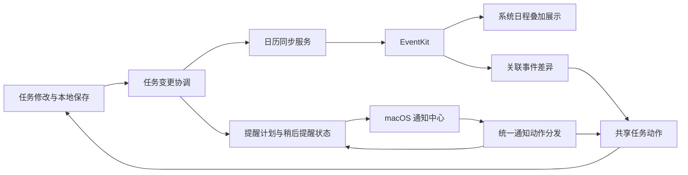

# 任务与 macOS 日历、到点提醒接入方案

日期：2026-10-18

分支：`experiment/macos-native`

状态：2026-10-19 首版接入已实现，定向回归及本批原生验收完成；提醒最后一组由用户手动操作，并核对应用动作记录。

用户已明确：提醒目标是任务到点响铃，支持稍后提醒和停止。接入目标按 Apple 日历与 macOS 通知系统设计。

## 1. 结论与范围

技术上可行。建议按“任务提醒闭环 → 任务导出到系统日历 → 系统日程叠加展示 → 已关联任务的有限双向同步”实施，每批单独验收。

| 能力 | 可行性与首版选择 |
| --- | --- |
| 已排期任务出现在 Apple 日历 | 使用 EventKit 创建并持续更新关联事件；默认使用用户选择的独立 WorkFollow 日历。 |
| Apple 日历中的已有日程出现在本项目 | 读取用户勾选的日历，叠加到本项目日历；保持日程身份，先提供只读详情。 |
| 在 Apple 日历修改已关联任务的标题、时间 | 可实现；放在基本同步稳定之后，只回写受支持字段。 |
| 任务到点有声音、可稍后提醒、可停止本次提醒 | 使用 UserNotifications 的声音、通知动作与本地提醒状态；应用运行时配合提醒面板和可停止的应用铃声。 |
| 应用完全退出后的提醒 | 已登记的系统通知仍可投递并发出短铃；用户点击通知动作时由系统交给应用处理。 |
| 完全退出后一直响到按停止 | 普通本地通知不足以提供此效果；需要独立常驻进程或维持主应用运行。首版采用系统短铃，持续响铃作为应用运行时的增强。 |

项目最低版本是 macOS 14。EventKit 的新访问授权接口从 macOS 14 可用，因此不需要为本次接入提高最低系统版本。读取日历、维护已创建事件都需要完整访问；仅写入权限不能满足持续更新、读取和删除需求。[Apple EventKit 授权说明](https://developer.apple.com/documentation/eventkit/accessing-the-event-store)、[macOS 14 接口变更说明](https://developer.apple.com/documentation/technotes/tn3153-adopting-api-changes-for-eventkit-in-ios-macos-and-watchos)。

通知可以显示操作按钮，由应用处理“稍后提醒”等动作。[Apple 可操作通知说明](https://developer.apple.com/documentation/usernotifications/declaring-your-actionable-notification-types)。系统负责应用未运行时的已登记通知投递，但通知并非严格的准时执行服务。[Apple 本地通知排程说明](https://developer.apple.com/documentation/usernotifications/scheduling-a-notification-locally-from-your-app)、[UserNotifications](https://developer.apple.com/documentation/usernotifications)。

## 2. 当前代码事实与缺口

以下是 2026-10-18 制定方案时的代码检查结果；当前实现与验收进展见文末。

| 现有基础 | 缺口与判断 |
| --- | --- |
| `TaskSchedule` 区分排期开始、结束、独立截止日期；提醒支持绝对时间与多个提前量；全天任务目前锚定 09:00。 | 可直接复用，不应在系统接入层另造一套时间规则。 |
| `NativeReminderService` 已请求通知权限、登记未来日期、排除已完成/删除/跳过任务，并覆盖倒计时来源。 | 没有通知类别、任务定位载荷和动作处理，也没有稍后提醒的持久状态。 |
| 服务有 `enable(for:)` 授权方法。 | 当前调用点搜索未找到任务界面的使用入口；专注模块会另外请求通知权限，应统一入口和状态反馈。 |
| `FocusNotifier` 设置共享通知中心的代理，前台策略仅返回横幅。 | 这是应用级共享代理，会影响任务通知；根据 API 行为，当前前台策略没有要求系统播放任务通知声音。需统一分发并做原生验证。 |
| 提醒变更已走 `TaskChangeSet` 和 250 ms 合并。 | 当前每轮删除任务/倒计时来源的全部待发请求，再重新添加；引入稍后提醒后会相互覆盖，应改为差量对账。 |
| 提醒签名在系统登记成功之前就更新。 | 登记失败后，相同输入可能直接被跳过，需要成功结果、重试状态与强制重新检查入口。 |
| 日历视图已经复用任务排期和 `TaskOccurrenceProjection` 的未来周期投影。 | 当前显示模型绑定 `Task`；系统日程需要独立显示类型，不能伪造普通任务以复用卡片。 |
| 任务已有资源链接、冷启动链接缓冲、共享任务动作和撤销。 | 可以复用任务定位；通知动作也需缓冲到工作区完成初始化。未来周期链接要带周期身份，不能全部定位到当前周期。 |
| 本项目已有菜单栏入口。 | 可利用已有进程运行时提供可控铃声；当前未发现登录启动接入。 |
| Native target 尚未接入 EventKit，也没有日历权限说明。 | 增加系统服务、持久绑定及设置 UI；如果启用 App Sandbox，还需日历访问 entitlement。 |

原生前台通知如何呈现由通知中心代理决定，声音是单独的呈现选项。[Apple 通知处理说明](https://developer.apple.com/documentation/usernotifications/handling-notifications-and-notification-related-actions)。

## 3. 用户能看到的交互

### 3.1 设置中的“日历与提醒”

- **任务提醒**：通知授权状态、声音开关、铃声试听、默认稍后提醒时长；提供“发送测试提醒”。默认稍后提醒 10 分钟。
- **连接 Apple 日历**：点击后请求完整访问；选择写入目标和需要显示的系统日历，默认建议独立的 WorkFollow 日历。
- **自动同步清单**：用户勾选需要自动同步的清单；已有任务首次连接时先显示同步数量和范围，再开始写入。
- **同步状态**：显示已连接、等待同步、需重新授权或具体失败原因，并可重新同步。
- **后台使用**：说明关闭主窗口后应用仍运行；登录启动由用户自行开启。完全退出后保留系统已登记的短铃提醒。

连接日历与开启提醒分开授权，任一项未开启时另一项仍可使用。

### 3.2 任务详情与日历

- 任务详情增加“同步到 Apple 日历”开关与关联状态；未排期时提示先设置日期。
- 清单自动同步与单任务开关合并为明确的有效状态；单任务取消可以覆盖清单默认，避免关闭后立刻被自动建回。
- 修改标题、排期或状态后自动同步，失败时在关联状态中显示重试入口。
- Apple 日历事件中的链接可回到对应任务；未来周期保留系列及周期身份。
- 本项目日历中的系统日程使用来源日历颜色和日历图标，不显示任务完成复选框；初期只能查看详情。
- 本项目自己导出的关联事件在叠加展示时合并到原任务，避免同一条排期显示两次。

### 3.3 到点提醒

系统通知展示任务名称、清单和时间，提供“稍后提醒 10 分钟”“停止本次提醒”；点击正文定位任务。系统决定通知按钮的具体呈现方式，应用内提醒面板可提供 5/10/30 分钟等选项。

- **稍后提醒**：推迟当前这条提醒，立即停下当前响铃；不修改任务排期、截止日期或重复规则。
- **停止**：停止应用播放的本次铃声、撤下本次通知并记录已处理；不完成任务，保留后来单独设置的提醒和未来周期。系统通知已经开始播放的短铃由系统结束，公开接口没有逐条停止该音频的控制。
- **完成任务**：走现有共享任务动作，取消该周期的待发提醒和稍后提醒，并停止其响铃。
- 重新排期、删除或归档时同步撤销失效提醒；撤销任务修改后按恢复的状态重新对账。
- 应用内可控铃声只在进程运行时提供；通知短铃和应用铃声统一声音策略，避免同时播放两份声音。P0 先验证前台、后台两种声音输出策略，P1 提供可控铃声；完全退出后使用系统短铃和可操作通知。

系统自定义通知音频要求小于 30 秒，不能把长音频循环直接交给通知中心。[Apple 通知声音说明](https://developer.apple.com/documentation/usernotifications/unnotificationsound)。普通提醒受系统通知、音量和专注设置影响；本次设计不申请紧急通知能力。[Apple Critical Alerts 说明](https://developer.apple.com/documentation/bundleresources/entitlements/com.apple.developer.usernotifications.critical-alerts)。

## 4. 日历字段、状态与重复任务规则

| 项目字段或操作 | 日历中的约定 |
| --- | --- |
| 标题 | 写入事件标题；有限双向同步阶段允许回写。 |
| 有时间的排期开始/结束 | 对应事件开始/结束。没有结束时间时使用可配置默认时长，建议 30 分钟，并标记为导出推导值；仅移动时间或修改标题时，不把推导时长偷偷写回任务。 |
| 全天、多天任务 | 对应全天事件。项目包含最后一天，EventKit 事件按结束边界转换；用日历日期运算处理，单独验证跨月和时区。 |
| 独立截止日期 | 保持独立，不拿来充当事件结束。可放在事件说明中；只有截止日期的未排期任务不自动导出。 |
| 无日期任务 | 保留在任务池；安排日期后再创建事件。 |
| 完成任务 | 保留事件并标记“已完成”，取消其提醒；保留排期历史。 |
| 删除、放弃或归档 | 取消未来受管事件与提醒，过去的日程历史保留；撤销后依据任务状态恢复。 |
| 仅取消日历同步 | 保留任务，移除关联管理。移除副本与保留为普通日程在解绑操作中明确选择。 |
| 外部删除已关联事件 | 标记关联被移除，不删除任务，也不立即自动建回；任务中提供重新关联/重新创建。 |
| 标签、优先级、附件、子任务 | 继续由任务管理；首版不在系统日历中构造对应字段或额外事件。 |

**重复任务推荐采用项目自己的周期投影，再输出独立日程。** 首版把未来 90 天作为默认投影窗口；应用启动、日期变化、唤醒和相关任务修改时补齐。按完成日期重复只导出已确定的当前周期，完成后再计算下一次。窗口长度是本方案的产品建议，不是 EventKit 的限制。

原因是项目支持农历、法定工作日、艾宾浩斯、按完成日期重复，以及单次例外；这些语义不能简单等价为一条普通日历重复规则。直接同时运行两个重复引擎会造成日期偏差和重复实例。复用 `TaskOccurrenceProjection`，用系列与周期标识建立绑定，沿用现有“本次/此后/全部”修改入口。按完成日期重复本来就不能提前确定下一次日期。

系统日历不能表达任务的完成状态，因此不能把双向同步理解为两个完全等价的任务系统。首版日历副本以任务为主；后续只对已关联事件的标题、开始、结束和全天属性开放回写。系统侧改动先作为待处理差异展示，避免一向同步阶段被应用静默覆盖。

**提醒只有一个默认负责方。** 任务仍由 WorkFollow 发出提醒，导出的日历事件默认不添加警报，并检查目标日历默认警报的实际行为。用户明确切换为日历负责时，才启用事件警报、停用对应任务的应用提醒。本项目不会再为只读叠加的外部日程另外发提醒。

## 5. 接入结构与数据流

建议增加以下边界，沿用现有工作区和持久化设施：

| 组件 | 职责 |
| --- | --- |
| `SystemCalendarService` | 封装 EventKit、权限、可写日历、日期范围读取及事件写入；不直接修改任务。 |
| `CalendarIntegrationStore` | 保存选中的读取日历、写入目标、清单默认、单任务覆盖与同步开关。 |
| `CalendarBindingStore` | 保存任务/系列/周期与事件的关系、上次同步字段快照、推导时长、待同步和外部解绑状态。 |
| `CalendarSyncCoordinator` | 消费任务领域变更；本地保存成功后串行同步；合并重复请求，失败保留待同步状态。 |
| `CalendarDisplayItem` | 区分任务与系统日程，复用布局算法，保留各自的详情和操作能力。 |
| `NotificationCoordinator` | 持有全应用唯一通知代理，注册任务/倒计时/专注类别；处理前台声音、点击定位及冷启动动作缓冲。 |
| `TaskReminderStateStore` | 持久保存每个周期、提醒时间点的稍后提醒和已处理状态；与任务本身的排期分开。 |
| `TaskReminderPlanner` | 纯计算应登记的通知与取消项；现有 `ReminderSchedule` 继续负责时间语义。 |

### 5.1 同步与恢复

1. 本地任务仍是完整任务数据来源。系统事件只承载选定字段，事件中保留回到任务的链接。
2. 绑定保存 EventKit 标识、任务来源链接、周期身份和上次同步字段快照。不能只存一个事件标识；Apple 说明完整同步可能使本地标识改变。查找失败时先尝试重新关联，不能直接再创建一份。[Apple 日历项标识说明](https://developer.apple.com/documentation/eventkit/ekcalendaritem/calendaritemidentifier)。
3. 系统变更通知不提供逐条差异。收到通知后合并刷新当前展示范围和受管范围，重新读取事件，再比较字段；不沿用失效的旧事件对象。[Apple 日历更新说明](https://developer.apple.com/documentation/eventkit/updating-with-notifications)。
4. 双向同步比较“上次同步快照、当前任务、当前日程”。只有一边改变则同步；两边改了不同字段可合并；同一字段冲突显示两个具体值供选择。自身写入后的通知经快照比较成为无操作，避免回写循环。
5. 外部日程回写走 `TaskActions`，支持撤销和现有重复范围语义。单个投影事件的修改对应本次周期，不擅自改整条系列。
6. 日历写入失败不回滚已经保存的任务；绑定保留等待状态，在恢复授权、回到应用或手动重试时重新对账。

### 5.2 提醒排程

- 使用稳定的来源、周期和提醒时间点组合区分通知，避免仅靠任务编号和数组位置。
- 计算正常提醒、稍后提醒与已处理状态的有效结果，只添加/更新差异并删除失效请求；不再清空所有任务提醒后重建。
- 系统排程成功才记录成功状态；失败保留重试能力。任务、倒计时和专注分别管理请求，统一注册所有通知类别。
- 日期重复复用现有周期引擎；先登记近期窗口内的提醒，按触发时间排序。初始窗口建议 30 天，实际登记数量预算由目标 macOS 原型验证确定，不套用其他平台的固定数量限制。
- 启动、唤醒、系统时区/时间变化时重新核对。较久之前错过的提醒合并为待查看列表，避免唤醒后逐条播放旧铃声。
- 长期不运行应用时，自定义周期只能覆盖已登记窗口；设置页展示提醒覆盖范围。无限期退出仍自动补齐，需要另行引入常驻提醒进程。

## 6. 按顺序实施与定向验收

| 批次 | 实施内容 | 完成条件 |
| --- | --- | --- |
| P0：系统接口原型 | 在独立验收数据和单独测试日历上验证授权、创建/读取/更新/删除一个事件；验证通知短铃与应用铃声的前后台分工、通知按钮、退出后投递和动作回调。 | 证明当前构建身份与目标系统的真实行为；未授权时入口有明确状态。登记数量和目标日历默认警报也在此记录。 |
| P1：任务提醒闭环 | 统一通知代理和权限入口；任务定位、提醒面板与可控铃声、稍后提醒/停止、状态持久化、差量排程；设置测试提醒。 | 前台和后台正常发声且不叠音；应用铃声可停止；10 分钟稍后提醒不改排期且重启后有效；停止不完成任务；完成/删除/改期与撤销正确更新提醒。专注、倒计时的相关通知各检查一次。 |
| P2：任务 → Apple 日历 | 配置目标日历；单任务/清单同步；持久绑定；标题时间状态更新；周期投影和来源链接；默认单方负责提醒。 | 新建、改期、完成、删除、撤销、重启均不重复创建；单点/全天跨日/重复任务日期一致；同一任务只响一处。 |
| P3：系统日程叠加 | 选择读取日历；引入独立显示类型；来源颜色、只读详情、任务副本合并和系统变更刷新。 | 日/周/月视图能同时显示任务与系统日程；重复事件只显示对应发生项；外部日程不出现任务复选框；原有任务拖动仍可用。 |
| P4：关联任务有限双向 | 回写标题和排期；支持本次周期、冲突处理、外部删除解绑和恢复。 | Apple 日历拖动后本项目排期及提醒一起更新；不发生来回写入；外部删除不删任务；撤销能同步回系统。 |

推荐先把 P0—P2 做成首个可用版本：用户可以得到完整任务提醒和系统日历中的任务副本，再逐步开放读取叠加与外部编辑。

回归只覆盖本批受影响部分：提醒计算/动作/持久化、日历映射/绑定、共享排期与撤销，以及被改动的日历布局。自动化测试用可控时钟和系统服务替身；真实权限、声音、通知按钮、跨应用修改各保留少量端到端案例。不会为每批运行全项目回归。

## 7. 分析依据与未验证项

本次读取了当前分支任务日程、重复投影、提醒服务、专注通知代理、应用生命周期、资源链接、设置和构建配置；核对了 Apple 官方文档及本机 SDK 的接口可用版本。

方案制定阶段未进行真实日历数据读写和通知动作验收；实施进度见下一节。持续响铃、睡眠时唤醒和系统专注设置下的强制响铃不属于普通本地通知所能保证的行为；首版承诺以已登记通知、用户授权和实际系统测试为准。睡眠后在唤醒时补核对，关机期间不承诺到点播放。

关键代码位置：

- [日程字段语义](/Users/dongyangwei/Documents/学习/代办笔记/workfollow-macos-native/macos-native/WorkFollow/Domain/Task/Task.swift:175)
- [当前提醒服务](/Users/dongyangwei/Documents/学习/代办笔记/workfollow-macos-native/macos-native/WorkFollow/Infrastructure/Notifications/NativeReminderService.swift:90)
- [当前共享通知代理](/Users/dongyangwei/Documents/学习/代办笔记/workfollow-macos-native/macos-native/WorkFollow/Application/FocusNotifier.swift:7)
- [未来周期投影](/Users/dongyangwei/Documents/学习/代办笔记/workfollow-macos-native/macos-native/WorkFollow/Domain/Task/TaskSeries.swift:154)
- [任务来源链接与冷启动缓冲](/Users/dongyangwei/Documents/学习/代办笔记/workfollow-macos-native/macos-native/WorkFollow/Application/NativeResourceLink.swift:3)
- [领域变更触发提醒](/Users/dongyangwei/Documents/学习/代办笔记/workfollow-macos-native/macos-native/WorkFollow/App/AppEnvironment.swift:160)

## 8. 实施进展（2026-10-19）

已实现：

- 统一任务、倒计时、专注的通知代理；任务通知载荷、来源定位、稍后提醒、停止、状态持久化和差量排程。
- 应用内提醒面板、前台可控铃声、后台系统短铃；4 个原创短铃资源；最近 24 小时错过提醒的处理入口。
- 通知状态、测试提醒、默认稍后提醒时长、铃声和登录启动设置。
- EventKit 完整访问入口、可写目标选择、独立日历创建与连接测试、清单预览及自动同步、单任务覆盖和解绑。
- 持久事件绑定、标识变更恢复、未来 90 天周期投影、外部删除后的解绑与重新关联。
- 系统日程在日/周/月视图及当天详情中的叠加；系统日程保持独立身份、来源颜色和只读详情。
- 活动任务关联事件的标题、排期有限双向同步、字段冲突选择、单次周期定位，以及共享任务动作的一步撤销。

验证：相关自动化 68 个案例通过；提醒队列补齐和倒计时路由后，补验 16 个相关案例通过，两轮覆盖有重合。没有运行全量回归。原生设置入口、首次清单同步预览、独立系统日历创建及 3 个验收任务的首次写入已确认。

提交前将本批 30 个文件及共享文件中必要的代码块独立暂存，并从暂存内容导出副本。该独立副本的构建及同一组 68 个定向案例均通过，其他任务、标签和过滤器改动保留在原工作区。

原生验收发现并修正了全天结束边界问题：在当前 macOS 27.0.1 上，向 EventKit 写入次日零点作为全天结束时，重新读取的结束值是次日 23:59:59。因此平台适配器写入包含日期的最后一秒，再将读取值归一化为应用使用的半开区间。自动化覆盖了这次发现以及跨时区日期还原；最新构建的真实读写和全天往返已通过。Apple 日历中 3 个验收任务均恢复为 10 月 18 日单日显示。

系统日程叠加已通过原生验收：在独立日历中创建 10 月 19 日 10:00—10:30 的临时日程，本项目的月、周、日视图均显示该日程，详情保留来源并说明可在 Apple 日历编辑。验收后已移除该临时日程。

关联事件回写已通过原生验收：在 Apple 日历将“准备季度复盘材料”改名并移到 10 月 20 日，本项目自动更新；在本项目一次撤销后，原标题及 10 月 18 日排期恢复，Apple 日历同步恢复。未完成任务支持这组回写；完成状态由任务端维护。

通知授权最初返回 `UNErrorDomain` code 1。授权入口改为进入前台再请求后，临时目录中的副本在前台仍返回同一错误，说明后台状态不足以解释失败。系统设置中已允许的是“WorkFollow Native”，未出现独立验收副本。将相同构建及签名复制到项目 `output/calendar-qa` 后，请求不再立即报错。用户完成该副本的系统提示后，接口返回允许，界面显示“系统通知已开启”。修复提醒浮窗后的构建也保留了通知授权。

测试提醒已由系统回调触发，声音对象确认处于播放状态。已将前台浮窗改为 `makeKeyAndOrderFront`，并明确设置切换应用后保持显示；后台仍只显示提醒，不激活整个应用。该修复构建及 5 个相关提醒测试通过。用户确认新版提醒出现，并手动确认停止有效、稍后提醒再次出现后可停止；应用记录也收到 `snooze` 和 `stop` 动作。原生工具始终绑定后面的设置窗口，因此最后一组使用手动交互加动作记录校验。窗口行为依据：[Apple NSWindow 文档](https://developer.apple.com/documentation/appkit/nswindow/makekeyandorderfront(_:))。

时长记录有一处差异：用户反馈按 5 分钟流程完成，动作记录实际为默认 10 分钟。验收据此确认稍后提醒功能和停止动作，不将其记为精确 5 分钟间隔验证。QA 未保存新的时长设置，默认值保持 10 分钟。

本批验收已结束。验收期间仅使用独立本地数据和「WorkFollow 接入验收 10-18」日历；未修改个人日程，外部临时日程已移除，关联任务的测试修改已撤销，Apple 日历已恢复月视图。本次仅修改提醒浮窗，不重复已完成的日历回归；该提醒构建更新后，QA 的日历权限被系统重置，正式使用时需对实际应用授权。

验收记录：[verification.json](/Users/dongyangwei/Documents/学习/代办笔记/workfollow-macos-native/docs/audits/macos-calendar-reminders-2026-10-19/verification.json)
