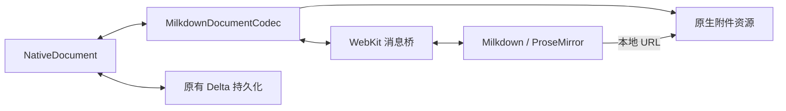

# Milkdown 编辑器全量替换

日期：2026-11-03。按用户要求直接替换全部生产正文入口，不增加原型窗口或切换开关。Milkdown 正文已接入全部生产入口并安装到日用 App。

## 范围

任务详情、笔记正文、AI 草稿、汇总文档、悬浮编辑器、浮窗接管后的只读预览，以及归档任务正文，统一使用 `DocumentEditor → MilkdownDocumentEditorView → MilkdownWebView`。

快速添加栏、任务行标题、普通标题输入和 AI 聊天输入框继续使用原有原生控件。它们不是富文本正文。

`DocumentEditor` 的调用参数保持兼容；宿主的 AI 选区、撤销、文件操作、正文切换和退出保存同步适配新内核。

## 数据与编辑架构



- 持久化仍是现有 `{ops, plainText}`；旧 `{blocks}` 文档沿用原有读取逻辑。
- Web 侧不是保存格式；编辑结果通过 `MilkdownDocumentCodec` 回到 `NativeDocument`。
- 段落 ID、缩进、编号起点、对齐、正文字号和检查项提醒/完成时间保留。
- 图片、附件和 DrawIO 的二进制/XML 留在原生资源表。Web 侧只接收引用、名称和显示尺寸，修改文字不重复传输这些大字段。
- 切换文档时释放上一文档的原生资源和代码高亮缓存；同一文档的资源保留给撤销使用。

### Schema

没有直接使用 CommonMark 的嵌套列表作为保存中间层。现有 `NativeDocument` 是平铺块数组，含独立 ID 和业务元数据；直接经过 Markdown 或常规嵌套列表转换会改变这些信息。

采用自定义 `wf_block`，承载现有八种块类型：正文、标题、无序列表、有序列表、检查项、引用、代码块、分割线。标题保留 1–6 级。列表通过缩进属性表达层级，父项移动时子项一起移动，编号按原有规则连续。

十三种原生标记均映射：粗体、斜体、下划线、高亮、删除线、行内代码、链接、弱化文字、说明文字、符号、语义颜色、文字颜色、自定义高亮色。

`wf_embed` 承载图片/附件、DrawIO、表格和公式；`wf_empty` 保留空 run 的样式，内部 `wf_run` 标记保留相邻 run 的边界。它们不会进入持久化协议。

### 消息与保存

每次装载携带 `documentID + epoch`，文档变化附带 `revision`。宿主只接收当前文档对应的消息；切换前通过 `flush` 提交到原来的回调，再装载下一篇正文。

普通文字、格式和表格/公式修改走同一条文档变更通道。宿主发起的关联插入、全文替换额外携带事务标识，撤销/重做时分别调用宿主的提交和反向提交回调，业务字段与正文保持一致。

退出 App 时先等待所有正文编辑器 `flush`，再执行原有存储刷新。悬浮窗关闭和文档拆卸也提交未处理的编辑。

## 能力对应

| 能力 | 实现 |
|---|---|
| 原生格式工具栏 | 继续复用 `DocumentEditorHandle`，命令转交 ProseMirror |
| 选区浮条 | Web 内显示，命令来自同一份 `DocumentProfile` |
| 斜杠菜单、块菜单 | 原生非激活子面板显示，不受短正文 WebView 边界裁剪；Web 侧管理查询、键盘选择与命令 |
| 输入期 Markdown | 标题、列表、检查项、引用、代码围栏、分割线及行内标记 |
| 复制/粘贴 | 原生私有格式、HTML、RTF、Markdown、文字和图片；继续复用现有系统剪贴板 codec |
| 图片 | 原生资源读取、正文预览、拖动修改尺寸、双击预览 |
| 表格 | 正文内编辑普通字符串单元格，增加/删除行列，纳入正文撤销 |
| 公式 | 正文内 LaTeX 输入和离线 KaTeX 排版，纳入正文撤销 |
| DrawIO | 保留原有独立编辑窗，正文使用新的 embed 和原生资源读取 |
| 链接 | 打开、复制、编辑、移除；悬停菜单使用同一原生浮层通道 |
| 检查项 | Web 复选框，原生提醒面板，保留业务元数据和可访问性状态 |
| 标签/清单补全 | 宿主提供候选与业务回调，原生浮层显示候选 |
| AI 选区润色 | 捕获文档、选区和版本，异步确认采用；支持多段文字及 Markdown 格式 |
| 撤销/重做 | ProseMirror history；App 菜单优先路由到当前正文 |
| 字号、主题 | 跟随原生设置；默认正文、独立字号、标题字号分别保留 |
| 长正文滚动 | 自适应宿主将滚轮交给外层 NSScrollView，固定视口在 Web 内滚动 |
| 光标定位 | 搜索、文末和检查项定位，将 Web 光标矩形传给外层原生滚动视口 |
| 正文周围空白 | 原有宿主命中层转交 Web 坐标，支持定位、Shift 扩选和拖选 |
| 方向键 | 由 WebKit 处理正文光标；段落操作按钮显式设为不可编辑，避免控件文字混入跨行导航 |

表格沿用 `NativeTable` 的字符串单元格模型，没有引入单元格内的第二套富文本模型。代码高亮使用 highlight.js 的 common 语言包，没有打包所有语言。

## 原有代码的保留范围

旧 `DocumentEditorContent` 正文包装已移除，生产正文没有切回旧内核的分支。

`DocumentTextCodec`、系统剪贴板/RTF 辅助，以及原有 TextKit 类型和相关测试暂时保留，供旧行为参考与原生富文本辅助使用。不能把这些旧类型的单元测试当成 Milkdown 验收；新回归直接加载生产 `DocumentEditor`，检查实际 WebKit DOM、原生模型、保存结果和宿主交互。

原方案中 `DocumentRichFormatCommands.swift` 的“11,906 行”是统计错误，实际为 244 行、11,906 字节；不能用该数推算迁移收益。原方案的“宿主零改动”和九个自定义声明也过于乐观，实际需要适配上述宿主通道和完整业务字段。

## 构建与分发

- 固定 Milkdown 7.23.0，前端源码在 `macos-native/WorkFollow/Resources/milkdown-web`。
- Xcode 的 `Bundle Milkdown editor` 阶段构建离线 JS、CSS、KaTeX 字体和第三方许可，打包为 `MilkdownRuntime.zip`。
- 首次从源码构建需要开发机上的 Node/npm；缺少依赖时脚本使用锁文件执行 `npm ci`。
- 分发 App 只包含 ZIP 运行资源，不包含 `node_modules`、前端源码、Node 或构建工具。
- 正文运行不访问 CDN，不依赖本地 HTTP 服务。AI 的本机 Pi/Node 配置沿用现有方案。
- `MilkdownResources` 在后台解包并缓存，`MilkdownSchemeHandler` 提供静态文件与附件读取。

开发验证：

```sh
python3 macos-native/scripts/package-milkdown.py
node --test macos-native/WorkFollow/Resources/milkdown-web/test/schema.test.mjs
WORKFOLLOW_DISABLE_SWIFT_SANDBOX=1 macos-native/scripts/run-tests.sh MilkdownDocumentCodecTests MilkdownEditorRuntimeTests
```

本机独立 `xctest` 可执行程序无法可靠承载 WebKit，因此 `run-tests.sh` 使用签名后的正式 App 副本加载 XCTest 包，并隔离存储。该测试入口只在专用编译条件下存在，不进入正常 Debug/Release 包。

## 验证记录

- JS Schema：10 项通过，覆盖全部块/标记/embed、空 run、UTF-16 选区、撤销、粘贴 ID、列表缩进和编号。
- 菜单修复后的真实 App 宿主定向回归：33 项通过，包含短正文原生浮层、菜单键盘选择、AI 对话、DrawIO 和任务详情层级。
- 方向键修复后的真实 App 宿主定向回归：17 项通过。新增用例使用原生按键，覆盖固定/自适应正文、自动换行、Shift 扩选及完整任务/笔记页面；同时复测 13 项编辑器能力。
- 方向键缺陷修复前，固定和自适应正文均出现跨段落后丢失列位置、向上不移动；将段落按钮设为 `contenteditable=false` 后，同一原生按键回归通过。
- 早先的广泛回归执行 541 项、跳过 1 项、失败 4 项；其中 3 项属于保留的旧 NativeTextView 测试，另 1 项是 AI 对话删除取消交互。该 AI 交互在后续菜单定向回归中通过；未将这一批记录为全部通过。
- 交互验收必须单独记录普通 App 的真实键盘、中文输入和滚动结果，不能用构建成功或测试包签名代替。
- Milkdown 及方向键修复已安装到 `/Applications/WorkFollow.app`，版本为 0.2.0（23），沿用现有任务和笔记数据目录。安装前已正常退出并备份工作空间数据库。
