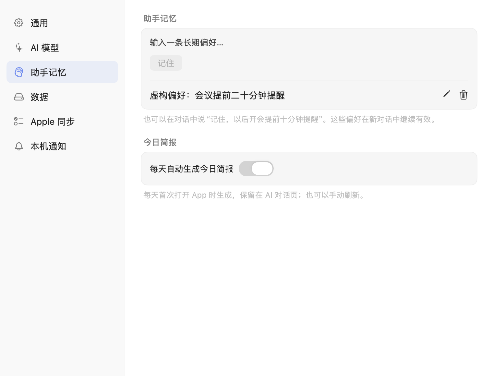
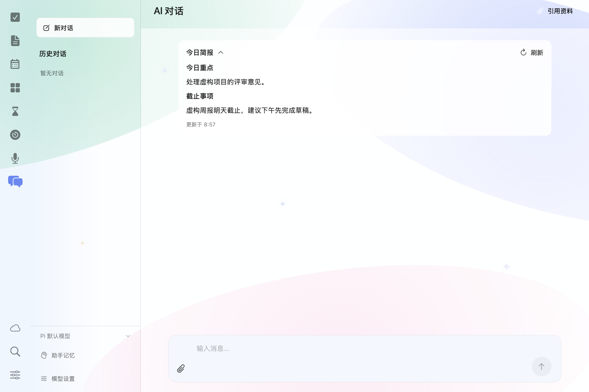

# 个人助手：长期偏好与今日简报

## 使用

在三个 AI 对话入口中，都可以说“记住，以后会议默认提前十分钟提醒”。Pi 通过原生 CLI 保存偏好；新建对话、切换入口和重启后仍会读取。说“改成提前二十分钟”或“忘记这条偏好”可修改或删除。普通讨论、笔记和附件不自动变成长期记忆。

设置新增“助手记忆”，支持查看、新增、修改和忘记偏好。AI 对话页左栏也提供同一入口。偏好用于工作时间、默认提醒、常用清单和表达习惯；任务日期、状态和项目进展继续读取业务记录。每轮显式要求优先于默认偏好。

AI 对话页显示可折叠的“今日简报”，支持流式生成、停止和刷新。默认每天首次打开 App 时生成；在“助手记忆”设置页可以关闭自动生成，手动刷新仍可使用。同一天成功生成后不重复调用模型，失败不反复轮询。App 前台跨日后会检查新日期。

简报提供今日安排、排期逾期、今起三天内或已经过期的截止事项及重要任务建议。它只生成建议，不创建、改期或完成任务。任务安排与截止日期独立；重复任务复用发生实例投影，链接指向实际来源任务。快照只包含 App 任务，不能据此判断完整日历中的空闲时段。

## 实现

- 原生 `AssistantMemoryStore` 保存 `modules/assistant-memory.json`，独立于 Pi 会话。新增、修改和删除在原子写入成功后才发布结果；修改和删除使用条目的最新版本，不改变业务任务和撤销历史。
- CLI 新增 `memory list/add/update/delete`。App 内 Pi 沿用 `WORKFOLLOW_CLI` 和 `WORKFOLLOW_APP` 定位当前实例，内置 WorkFollow Skill 补充相应命令及长期偏好语义。成功写入仍由原生接口生成操作回执。
- `AIConversationClient` 在每轮发送时读取同一份最新偏好。三个入口共用后端 `memory_context`，明确当前快照优先于旧会话里的偏好。Pi 继续管理对话历史、压缩和重试。
- `AssistantBriefingFacts` 从不可变任务快照在后台构建元数据，不读取整篇任务正文。普通前台激活先检查日期缓存，已经完成当天简报时不扫描任务。
- 后端 `assistant.briefing` 复用 Pi 文字流，关闭工具与持久会话。现有文字请求优先于后台简报，主动请求会取消后台生成；已经有主动请求时简报不抢占。
- `AssistantBriefingStore` 保存 `modules/assistant-briefing.json`，包含自动生成开关、成功记录和生成时的任务快照；该参考快照在独立聊天中可用，执行操作前仍读取最新业务记录。
- 记忆和简报沿用工作区模块导出。导入或恢复工作区时停止尚未完成的简报，等待正常重启后读取替换的数据。

三个对话入口和今日简报使用当前 Pi 文字模型配置，无新增模型服务或运行时依赖。

## 验证

- 65 项相关原生回归通过，包括长期偏好持久化、版本更新、跨入口读取、每日去重、跨日、手动刷新、设置真实控件、完整聊天壳层，以及既有对话、附件、CLI 和导出。
- 55 项后端回归通过，包括当前记忆快照、只读简报、正文流，以及主动请求与简报之间的优先级处理。
- WorkFollow Skill 通过 skill-creator 的结构校验；实际 Pi 验收使用该 Skill 和真实原生 CLI。
- 当前 `ali-Pi/kimi-k3` 在独立验收 App 中完成六轮虚构资料测试：记住、新对话回忆、更新原条目、简报、忘记、新对话确认已忘记。核对了偏好记录、简报前后任务一致性，以及任务和笔记数量；引导数据以启动时数量作为基线。
- 实测发现模型将会议开始时间写成结束时间，已补充字段语义及日历范围说明。再次实测明确输出“15:00 开始”、结束时间未知，建议提醒时间为 14:40，未修改实际任务。
- 实测详情见 [虚构资料报告](research/personal-assistant-live-2026-11-03.json)。亮暗两种简报外观已检查。
- 最终 Release 0.2.0（19）已构建并通过签名与打包验证；包内后端、WorkFollow Skill 与最终源码一致，附带 CLI 的帮助已核对包含记忆命令。

本轮只生成 Release 包，日用 App 未替换，代码未提交或推送。
