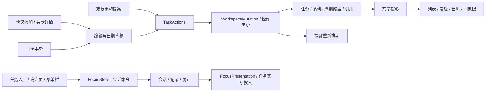

# 滴答 macOS 四模块复刻方案

整理日期：2026-10-14。目标分支：`experiment/macos-native`。目标客户端：本机滴答清单 macOS 8.0.80。录入对照和演示数据固定在 2026-10-13，时区 Asia/Shanghai。

建议将目标定为：在相同任务、窗口和设置下，待办、日历、四象限、专注的主要页面和正常操作流程与该版本滴答一致。交付按“页面状态、交互结果、数据结果”逐项验收；一个静态页面相似，不能代表该功能已经复刻完成。

分模块设计、REA证据和可交互样板已用于实施。原生落地、测试结果、实际截图及尚未完成的复刻对照见[实施与验收](/Users/dongyangwei/Documents/学习/代办笔记/workfollow-macos-native/docs/ticktick-replica-implementation-2026-10-14.md)。下方样板结果仍只代表方案阶段。

## 1. 证据如何进入设计

| 依据 | 本轮已经得到什么 | 用于决定什么 |
| --- | --- | --- |
| REA 6.4.0 原生元数据 | 本机主程序与模型框架的类、方法、属性声明 | 功能边界、重复字段、会话及记录模块；方法名不直接当成算法 |
| REA 界面资源解码 | 56 份选定资源中的控件、outlet/action、归档布局信息 | 待办独立完成框、日期/重复面板、三种重复修改范围、专注调整/收获/记录编辑入口 |
| REA 只读运行观察 | 指定本机滴答主窗口的截图和可访问控件；该次窗口为 1512×859 | 主框架、分栏位置、实际控件呈现；归档 NSFrame 不替代运行时尺寸 |
| 客户端录入实测 | “下周一上午9点”预览 10月19日09:00；“明天9:00-10:00”识别首个09:00，尾段留作文字 | 快速添加的自然周及日期/时刻组合规则 |
| 当前分支源码与复现 | 已有时间段、农历/艾宾浩斯、看板、分组、日期草稿、编辑器、集中动作、专注与 SQLite；正常路径差异已复现 | 保留可用层，修复具体问题，避免重新写四套业务逻辑 |
| 官方桌面说明 | 周时间轴、安排池、重复起算、象限规则、完成后修正时间等 | 功能合同；帮助页的更新版本与本机 8.0.80 分开记录 |

完整依据：[对比审计](/Users/dongyangwei/Documents/学习/代办笔记/workfollow-macos-native/docs/ticktick-rea-audit-2026-10-13.md)、[REA 设计证据](/Users/dongyangwei/Documents/学习/代办笔记/workfollow-macos-native/docs/design/ticktick-replica-2026-10-14/rea-design-evidence.json)、[选定官方文章](/Users/dongyangwei/Documents/学习/代办笔记/workfollow-macos-native/docs/design/ticktick-replica-2026-10-14/official-selected-articles.json)。

REA 已确认 `TTRepeatChangeAlertViewController` 有 `onlyThisButton / thisAndFutureButton / allNotCompletedButton`；`TTFocusViewController` 有三个 actionButton、本次 +/- 和 harvest 区域；记录编辑有任务、类型、开始、结束、笔记和保存/取消。这些是确定的结构事实。按钮如何影响已有例外、番茄怎样计数，仍需同版本运行观察，不能凭控件名填答案。

## 2. UI：按整套状态复刻

### 2.1 主框架和组件规格

保留本项目原生技术栈及 `RootShell`、共享详情和正文编辑器。为四个模块使用同一套主导航、工具条、任务行、属性弹层和反馈样式。组件规格需同时记录尺寸、布局、文字、图标、命中区、焦点和状态。

本次待办窗口的分隔线约在 x=61、273、643；对应导航轨约62、清单栏212、任务栏370个截图单位。这是一次运行布局的测量锚点，不能当作任意窗口下的固定列宽。实施先确认截图与内容区坐标/显示缩放的映射，再校准可拖动分栏与最小宽度。

设计参数采用三层组织，最终接入现有 `WF*` 主题及各模块 `*LayoutMetrics`：

| 层 | 内容 | 约束 |
| --- | --- | --- |
| 基础参数 | 颜色、系统字体、字重、字号、间距、圆角、线宽、阴影、图标尺寸 | 由同版本运行截图或原生属性确定；每个值注明已测/待测 |
| 语义参数 | 主/次文字、普通/选中/悬停背景、边界、强调、逾期、优先级、清单颜色 | 浅色和深色分别校准；同一含义跨模块一致 |
| 组件参数 | 导航轨/清单栏、任务行/看板卡、日期面板、日历块/全天区、象限头、计时环、记录行 | 组件集中引用参数；不把截图值散写进 View |

不能用旧 Flutter 注释、当前项目常量或 nib 保存尺寸证明已经对齐滴答。UI 校准的直接依据是实际客户端同状态画面。

### 2.2 页面与状态清单

| 模块 | 页面结构 | 必须做齐的状态 |
| --- | --- | --- |
| 待办 | 导航轨 → 清单/过滤器/标签 → 列表或看板 → 共享任务详情 | 空列表、普通/选中/悬停/已完成行，快速录入及候选、右键、子任务、标题/正文编辑、日期/重复草稿、预计/实际投入 |
| 日历 | 工具条 → 日期列头 → 全天/跨天区 → 时间轴；安排任务面板按开关呈现 | 月/周及已确认菜单模式，时间点/时间段/重叠块、+N 完整列表、拖动预览/边缘调整/取消、未来周期及范围选择、显示设置 |
| 四象限 | 工具条 → 2×2象限 → 清单分组及任务行 | 各象限空/有任务、规则编辑、改名/换位置/排序，象限内创建、跨象限属性变化预览、同象限排序、详情 |
| 专注 | 左计时区 → 右概览/活动详情/完成总结/记录/统计 | 番茄与正计时空闲/运行/暂停、休息、选择任务、本次调整、笔记、结束/放弃、补记/记录编辑、菜单栏、Mini/沉浸入口 |

每个页面都要形成状态对照，不只比默认截图。侧栏详情与日历/象限浮层保留各自宿主，内部任务内容使用同一组件。

## 3. 功能与交互：四条主链

### 3.1 待办：录入、编辑、重复、撤销

列表和全局添加共用 `QuickCaptureSession`，维护原文、光标、识别片段、人工属性和待提交草稿。解析结果先拆日期/时刻/重复/组织属性，再组合；人工确认的日期不被后续标题解析覆盖。候选跟随真实光标位置，中文输入法提交与回车创建分开。

详情共用 `TaskEditorSession`，固定 taskID 和打开来源，延续现有编辑器提交路径。日期、提醒、重复都进入 `TaskDateDraftModel`；取消丢弃草稿，最终确认形成一个 `SchedulePlan` 和一个业务事务。精确的面板关闭提交策略、候选键序按本机补测冻结。

列表和看板读同一排序/分组投影；看板完成框、右键、列内添加和拖动调用同一动作。先修看板排序失效、清单/标签日期分组失效，以及重复下一期丢失 sectionID。

重复增加到期日/完成日/自选日期、多个星期几、序数规则、结束条件，以及 `TaskSeries / OccurrenceKey / OccurrenceOverride`。周期身份锚定未改期前的名义周期；未来只投影，编辑时才落地。三种修改范围对应本次覆盖、此后系列分段、未完成范围更新；对既有例外和已完成历史的具体影响须补测后定稿。

### 3.2 日历：真正可排期的时间轴

启用并补齐周时间轴，将日期点、时间点、时间段、全天跨天分别投影。时间块相交时分道；块的最小可见高度不自动写成任务时长。浏览、选中日期、工具条标题、新建默认日和模式切换由一个 `CalendarViewport` 管理。

桌面官方流程为：单击时间轴创建时间点，按住拖动创建时间段，拖块移动，拉边缘改变起止。不得把移动端默认一小时套到桌面单击。拖动中只更新预览；松开后提交一次动作；Esc 返回原安排。

安排池支持无日期任务入日历。月格 +N 打开当天完整列表；完成、未来周期、检查项、专注等开关进入共用显示配置。先修当前 +N 只选日期、月/周完成开关不同、翻页新建日期不随浏览变化、跨天任务在后续日期消失等问题。

### 3.3 四象限：规则、布局与属性分开

提供优先级映射、时间+优先级、清单/标签/日期/优先级条件；规则、名称、布局顺序、手动行序各自有稳定身份。本项目当前“今天+3天”只能保留为旧规则，不能标成已确认的滴答默认。

跨象限拖动先用 `MatrixDropProposal` 算满足目标的最少属性变化，并展示将改哪些字段。已有日期/优先级已经满足时保留；优先级和排期一次提交、一次撤销。同象限落下只处理手动行序；象限换位置只改布局。

### 3.4 专注：会话、记录、统计使用同一事实

当前会话捕获真实 mode、target、任务和时间锚点；默认设置只用于下一次。每秒由同一个 `FocusPresentation` 更新页面及菜单栏；运行和暂停按时间段算有效秒数，不由 View 自己递减。

“选50分钟预设”和“明确调整本次 +/-”分成两个操作。结束、放弃、跳过休息分成不同命令。自然到点进入完成总结，修正/追加更新同一记录；自动休息、自动下一轮和轮数分别设置。

记录增加模式、来源、结束原因、起止、有效秒数、暂停、番茄计数口径。补记和编辑使用同一完整表单，可指定昨天、任务及笔记。概览、任务实际投入、历史和统计读取同一查询；编辑归属会同时从旧日期/旧任务移出，计入新日期/新任务。

计数与舍入集中到 `FocusAccountingPolicy`。正计时、提前结束、放弃、补记的番茄数必须实测，不能继续把 completed=true 都算一个番茄。铃声保存稳定 ID，显示名与系统声音名分开，关闭时通知也无声。

分模块完整合同和现有文件落点：[待办设计](/Users/dongyangwei/Documents/学习/代办笔记/workfollow-macos-native/docs/design/ticktick-replica-2026-10-14/tasks-design.md)、[日历与四象限设计](/Users/dongyangwei/Documents/学习/代办笔记/workfollow-macos-native/docs/design/ticktick-replica-2026-10-14/planning-design.md)、[专注设计](/Users/dongyangwei/Documents/学习/代办笔记/workfollow-macos-native/docs/design/ticktick-replica-2026-10-14/focus-design.md)。

## 4. 统一实现边界

以下是本项目的实现选择，不是声称恢复了滴答内部源码：

1. **一个任务编辑上下文。** 任务详情内容共享，宿主决定呈现方式；切换任务先完成当前输入法/正文会话。
2. **一个领域修改入口。** 一次用户动作形成 `WorkspaceMutation`，包含任务、系列、周期覆盖及相关业务排序；发布一次完整变化。提醒和各视图消费同一个结果。
3. **一套业务历史。** 保存前后值与选择落点；撤销恢复 before，重做应用保存的 after，不重新生成身份或日期。文本 first responder 保留原生撤销。
4. **一个周期模型。** `TaskSeries` 保存模板、规则、时区与锚；`OccurrenceKey` 保存 seriesID、名义日期与序号；`OccurrenceOverride` 保存本期改期/跳过/完成。不同模块不再各算下一期。
5. **一个计时会话。** 运行事实独立于页面及下次偏好；会话结束与记录写入在同一事务完成。页面切换不启动或终止计时。
6. **稳定组织引用。** 清单、标签、分组、过滤器、象限条件按 ID 关联，名称用于显示；改名更新同一实体。

视图偏好采用独立的 `ViewConfigurationCommand`，不挤入任务撤销栈；需要撤销的规则/布局设置使用配置历史。专注记录编辑使用 `FocusRecordCommand`，不通过任务撤销回拨已发生的时间。

## 5. 数据迁移

新增字段与表先兼容读取旧数据，再切换投影和写入。保留原 taskID、记录 ID 和正文引用；旧重复链仅按已有可证明的关系建立系列，不凭标题相同自动合并。

旧专注记录只有分钟与 completed 时，标为 legacy，保留原时长及既有计数；模式、暂停和真实结束未知就保持未知。新记录保存精确秒数和明确口径。SQLite、JSON 导入导出、预览初始化使用同一 decoder。

旧象限三天规则保留为可识别的兼容配置，用户切换到已确认的滴答规则后才重投影。旧提醒没有相对/绝对锚定信息时保留原语义；新提醒明确锚点。存储升级前后核对记录总量、组织引用和当前暂停会话，不重建用户数据。

## 6. 分批实施与交付门槛

每批同时交付可运行页面、交互合同及数据验证。视觉校准跟随稳定的操作流程，最后做贯穿复验。

| 批次 | 具体工作 | 本批完成标准 |
| --- | --- | --- |
| A：基线及已有缺陷 | 固定8.0.80状态样本；修自然周/时刻覆盖、看板排序、下一期分组、日历浏览/完成开关/+N、象限单事务、专注模式/刷新/时长记录/铃声 | 已复现的正常路径差异消除；现有功能可继续使用；记录并冻结第一组 UI 参数 |
| B：待办公共链 | 共享录入/候选、共享详情、日期草稿、统一事务与重做、稳定组织引用、列表/看板投影；任务预计/实际接口 | 同一任务从任一入口录入和改期结果一致；确认/取消及撤销有明确落点 |
| C：重复系列 | 三种起算、多星期几/序数/结束条件，周期身份、未来投影、三种作用范围和例外 | 预览与生成一致；只改本期不污染其他周期；完成及撤销保持分组和周期身份 |
| D：日历排期 | 时间轴、全天/跨天、重叠分道、安排池、创建/移动/边缘调整、显示配置、可见窗口缓存 | “录入→排期→调整→撤销”全链路正确；未来周期和普通任务共用手势及详情 |
| E：可配置象限 | 规则编辑、名称/布局/排序、拖动提案、象限内创建、配置持久化 | 同象限不改任务属性；跨象限一次修改/撤销；规则切换只重投影 |
| F：专注完整链 | 会话/口径/迁移、当前调整、完成总结/追加、自动休息与下一轮、记录详情/补记/编辑、任务投入、统计、菜单栏/Mini/沉浸 | 开始→暂停→结束→记录编辑→任务实际→统计一致，页面和菜单栏同状态同后果 |
| G：全链路对照 | 全部确认状态的几何/主题/字体/弹层/焦点、键盘、正常手势、持久化接续 | UI、交互、数据三层全部通过；未实测条目明确保留待确认，不标为复刻完成 |

A 中专注的模式/时长错误优先修复；F 做完整模块。B、C 是日历与象限共享基础，不能各自在 View 临时补一套重复或撤销逻辑。

实施文件已列在分模块方案末尾。沿用 `TaskActions / WorkspaceStore / TaskDateDraftModel / TaskInspectorShell / DocumentEditorHandle / FocusStore / SQLiteRecordStore`，新增会话和投影边界，避免全面重写。

## 7. 如何验收到“复刻效果”

### 7.1 对照方法

为每个正常流程记录：相同初始数据与设置 → 同一鼠标/键盘输入 → 每一步可见状态 → 最终字段、关联、提醒、计时与撤销结果。REA 观察客户端窗口和控件，本项目通过现有 accessibilityIdentifier、RenderAnchor 和 render contract 记录同一状态。

UI 在同版本、窗口内容区和缩放下对照。建议将固定锚点偏差 ≤1pt 作为工程目标；它是验收目标，不是本轮测得的完成结果。重点校验分栏、文字基线、行高、图标、弹层落点和任务块，逐个解释差异；光标闪烁、走动的秒数单独对齐，不用一个模糊的整图百分比掩盖差异。浅色/深色及常用窗口尺寸都要覆盖。

### 7.2 主路径验收卡

| 合同 | 正常路径 | 必须确认的结果 |
| --- | --- | --- |
| T01 | 列表与全局录入“下周一上午9点” | 固定10月13日起点时均为19日09:00；人工日期覆盖保持 |
| T02 | 日期/重复草稿编辑，取消或确定 | 取消无写入；确定一次提交；一步撤销完整恢复 |
| T03 | 清单改名、切看板、改排序/日期分组 | 过滤器/象限/日历引用有效；列表与看板实际顺序一致 |
| R01 | 分组内完成重复任务，再撤销/重做 | 下一期分组保持；重复链、提醒和任务身份一起恢复 |
| R02 | 日历未来周期仅本次改期 | 原位置无重复残影；其他周期不变；刷新/重开后仍同一期 |
| C01 | 单击时间轴、拖选范围、移动/拉边缘 | 时间点不自动成为一小时；移动保时长；边缘只改对应起止 |
| C02 | 翻月→新建→切周→跨天→+N | 浏览锚点一致；跨天后续日期可见；+N 显示完整列表 |
| M01 | 改规则、象限换位置、同象限落下、跨象限移动 | 配置/布局/任务属性各有明确后果；跨象限一次撤销 |
| F01 | 任务正计时90秒、暂停、重开 | 数字持续刷新；真实模式保持；暂停时间不计入有效时长 |
| F02 | 25分钟运行中选50分钟；再显式调整本次 | 预设仅影响下次；本次调整才改变当前目标及最终记录 |
| F03 | 自然结束/提前结束/放弃/休息 | 结束原因与计数符合实测口径；休息不计专注；主页面/菜单栏一致 |
| F04 | 昨天补记，编辑日期/任务/时长和笔记 | 同一记录更新；历史日期、任务投入、今日与总统计一起正确 |
| X01 | 同一任务录入→日历安排→象限调整→专注→复盘 | 详情、排期、周期、预计/实际、记录归属与撤销贯通 |

测试集中于这些正常路径及已经复现的问题。设计文档和可交互样板可审阅；原生实现需另跑对应领域、持久化、交互及视觉合同。

## 8. 实施前需要补齐的客户端观察

| 内容 | 为什么影响复刻 | 冻结位置 |
| --- | --- | --- |
| 候选键序、详情弹层关闭、日期子页返回 | 决定焦点、Esc和提交边界 | 录入/编辑状态机与组件合同 |
| 三种重复范围、逾期完成、完成日起算未来展示 | 决定系列分段、覆盖与下一期 | RecurrenceEngine合同 |
| 8.0.80实际视图菜单、跨天块、时间步进/缩放/命中区 | 决定日历入口、布局与手势 | CalendarProjection和InteractionController |
| 象限默认规则、规则重叠/不命中、拖动组织属性 | 决定分类和移动后的字段 | MatrixRuleEvaluator / DropProposal |
| 正计时/提前结束/放弃/补记/追加的计数及舍入 | 决定所有统计是否与滴答相同 | FocusAccountingPolicy |
| 记录删除、自动轮数、运行中换任务、Mini/沉浸 | 资源或文档证明入口，精确行为尚未全部观察 | 专注命令与页面合同 |

这些待确认事项不会阻止修复已证明的问题或先搭公共链；相关批次验收前必须补齐，不能把建议值包装成滴答事实。自然语言自动识别完整时间段等增强项单独排期，以免改变已确认的 8.0.80 行为。

## 9. 本轮交互样板验证

以下结果来自方案样板中的固定示例数据，只用于验证所设计的状态联动；原生分支的功能验收在实施阶段执行。

| 操作 | 观察结果 |
| --- | --- |
| 日期草稿改到14日后取消、再确认 | 取消仍是13日09:00；确认后列表与详情均为14日09:00；一次撤销恢复 |
| 四象限改用时间+优先级并限定生活清单 | 显示对应清单任务，按新规则重新归类 |
| 从周视图翻到下一周、切月再翻到11月 | 日期列和月份更新；该浏览窗口新建草稿默认11月1日 |
| 正计时开始、写笔记、暂停、结束 | 秒数递增，暂停冻结；完成总结显示实际时间与同一笔记 |
| 25分钟运行中选择50分钟，再显式 +5分钟 | 当前仍25:00；显式本次调整后30:00；暂停后状态为已暂停 |
| 给昨天补记30分钟 | 今日保持65分钟，累计变95分钟，记录归入昨天 |
| 将今日40分钟记录改为昨天30分钟并换绑任务 | 今日25分钟、累计55分钟；任务详情实际投入55分钟；仍为原记录 |
| 常用桌面宽度及320/360窄宽度 | 页面可重排；已检查模块的根容器没有横向溢出；修正今天按钮和当前日列头布局 |

样板 JavaScript 语法检查通过，最后观察的控制台无错误。它未实现全部重复规则、原生日历布局、计数政策、快捷键和持久化；这些由分模块合同定义。安排池的 CUA 坐标拖动未得到可见状态变化，因此未计为验证通过；移动与边缘手势仍需在原生实施时按 C01/X01 逐项验收。精确像素对齐和所有客户端待确认项也没有标记为完成。
